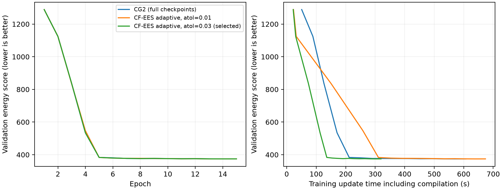

# Kuramoto GPU comparison, 25 September 2026

Adaptive CF-EES completed 15 epochs with final test loss 370.7818, compared with 370.6795 for CG2. Its complete invocation took 396.05 seconds versus 702.62 seconds: **1.77× faster**, with a 0.028% higher final test loss.

| Method | Best validation loss | Final test loss | Complete invocation | Training updates, including compilation |
| --- | ---: | ---: | ---: | ---: |
| CG2, full checkpoints, 75 fixed steps | 374.2530 | 370.6795 | 11.71 min | 607.58 s |
| CF-EES, adaptive, recursive checkpoints | 374.3207 | 370.7818 | 6.60 min | 319.74 s |

Both runs used seed 0, 15 epochs, the same N=1000 dataset, batch size 32, four forecast samples and the same model architecture, loss and learning-rate schedule on an NVIDIA GeForce RTX 5080. This is one seed. CF-EES uses recursive checkpointed gradients, tolerance 0.03, maximum step 0.5 and minimum step 1e-6. This adaptive training result is separate from the fixed-step checkpoint-free reconstruction comparison.

This checkpointed result does not establish the requested reversible-training performance. The launcher default has been restored to reversible reconstruction; reproducing this benchmark requires explicit `--adjoint checkpoint_recursive --n-steps 10 --adaptive-atol 0.03 --adaptive-dtmin 1e-6` options with `--adaptive`. The implementation applies diagonal diffusion directly and saves only the loss's requested observation times. The endpoint controller preserves genuine minimum-step failures while allowing an accepted final step clipped to the remaining interval. Resume accepts the last fully evaluated epoch's matching model and optimiser when final checkpoints are absent.

## Saved results

- [CF-EES best model](cfees25_adaptive_fast_verified/model_best.eqx), [final model](cfees25_adaptive_fast_verified/model_final.eqx), [history](cfees25_adaptive_fast_verified/history.json), [metrics](cfees25_adaptive_fast_verified/metrics.json), [log](cfees25_adaptive_fast_verified.log).
- [CG2 best model](cg2_full/model_best.eqx), [history](cg2_full/history.json), [metrics](cg2_full/metrics.json), [log](cg2_full.log).
- [Comparison plot](comparison.png), [PDF](comparison.pdf), [numeric summary](summary.json), [commands and all trial outcomes](comparison.json).
- [Validation](validation.json), [dependency provenance](provenance.json), [failure reproduction](failure_reproduction.json).

The completed tolerance-0.01 CF-EES trial also matched CG2's loss but took longer; it is included in the plot. Interrupted reconstruction and failed higher-minimum-step trials remain in the trial records and are excluded from the successful comparison.

All 42 focused tests and 11 unittest subtests passed. Both selected runs have 15 finite epochs, loadable best/final model checkpoints, saved final optimiser states and finite demonstration forecasts.

## Timing

Complete-invocation times come from the external drivers' monotonic clock and include setup, compilation, training, validation/test evaluation and artifact saving. CG2's raw epoch-four and total training wall-clock fields contain a system-clock jump; those values are not used in this comparison. The training loop now uses a monotonic clock too. The time axis in the plot sums synchronised training-update measurements and excludes evaluation.
